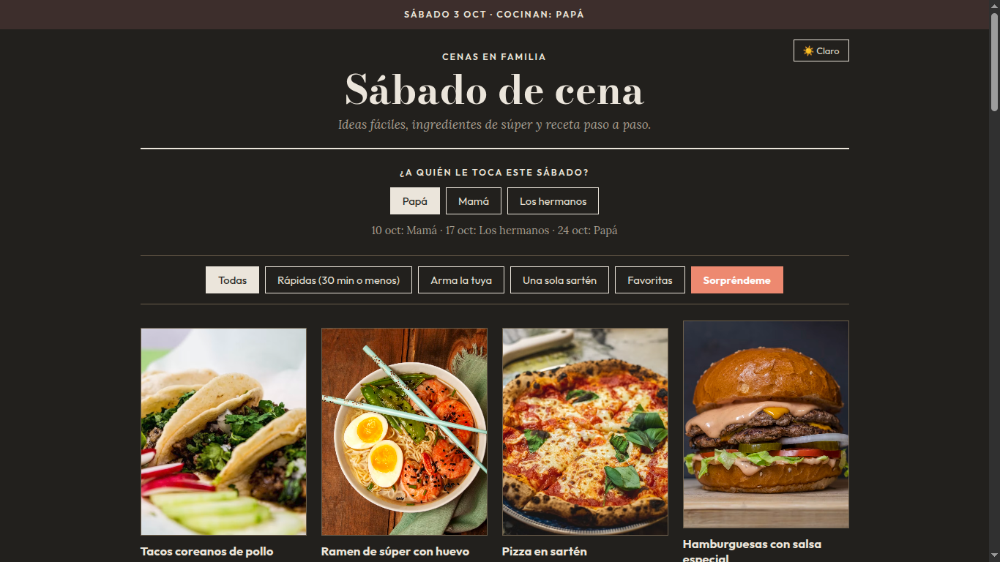
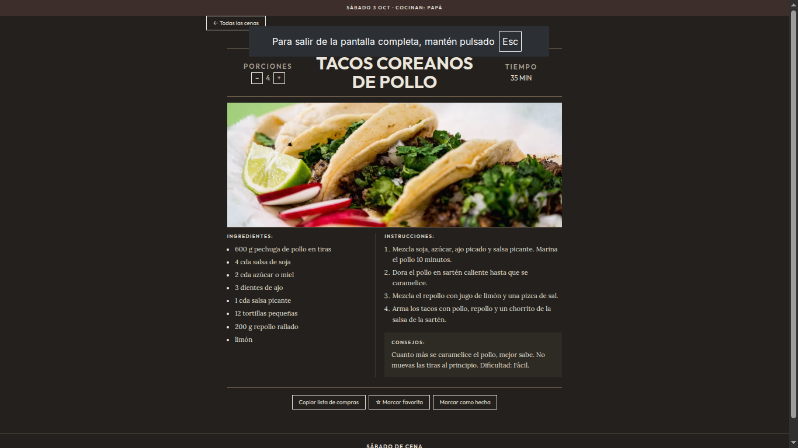
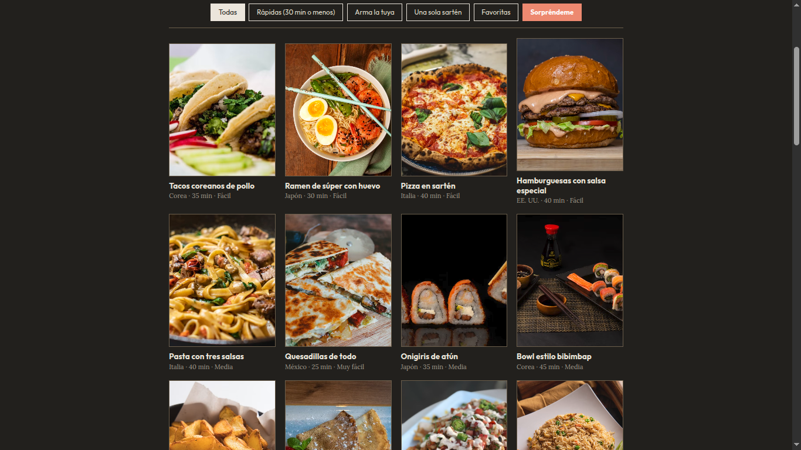

<div align="center">

# 🍽️ Sábado de Cena

### Una idea rica para cada sábado, sin complicar la cena.

Recetas para compartir en familia: descubre qué cocinar, ajusta las porciones y deja que la próxima cena se convierta en un nuevo momento para compartir.

<br>


</div>

---

## 🍴 Sobre el proyecto

**Sábado de Cena** es una aplicación web de recetas pensada para convertir la pregunta de *"¿qué cocinamos este sábado?"* en una experiencia sencilla y entretenida.

La aplicación reúne recetas de diferentes estilos y culturas en una interfaz visual, permitiendo descubrir nuevos platos, consultar sus ingredientes y prepararlos paso a paso.

Más que un recetario, el proyecto busca crear una pequeña tradición alrededor de la comida y el tiempo en familia.

---

## ✨ ¿Qué puedes hacer?

### 🔎 Descubrir recetas

Explora una colección de recetas con información clara sobre cada plato:

- Ingredientes
- Instrucciones paso a paso
- Tiempo de preparación
- Dificultad
- Cantidad de porciones
- Consejos de cocina
- Fotografías de los platos

### 🥘 Encontrar qué cocinar

Filtra y explora recetas según diferentes estilos e ideas para la cena, incluyendo:

- ⚡ Cenas rápidas
- 🍳 Recetas de una sartén
- 🌎 Cocina internacional
- 🍝 Pastas
- 🍚 Arroces
- 🌮 Comida mexicana
- 🍣 Cocina asiática
- 🥗 Opciones para armar al gusto

### 👨‍👩‍👧‍👦 Pensado para compartir

La aplicación permite ajustar las cantidades de una receta según el número de personas, facilitando la planificación de una cena familiar.

También puedes utilizar la rotación para organizar quién se encarga de la cena de cada sábado.

### ❤️ Guardar tus favoritas

Marca las recetas que más te gustan y lleva un registro de las cenas que ya prepararon.

### 🌙 Una experiencia adaptable

Disfruta de la aplicación con tema claro u oscuro y una interfaz adaptable a diferentes tamaños de pantalla.

---

## 🍝 Recetas

La colección incluye recetas inspiradas en diferentes cocinas y estilos gastronómicos.

Entre ellas encontrarás platos como:

| Cocina | Ejemplos |
| --- | --- |
| 🇮🇹 Italiana | Pastas, lasaña, pizza |
| 🇯🇵 Japonesa | Ramen, tonkatsu, onigiri |
| 🇰🇷 Coreana | Bibimbap y otras especialidades |
| 🇲🇽 Mexicana | Tacos, quesadillas, huevos rancheros |
| 🇺🇸 Estadounidense | Hamburguesas, mac & cheese, pancakes |
| 🇪🇸 Española | Tortilla española |
| 🇬🇷 Mediterránea | Ensaladas y platos mediterráneos |
| 🌎 Internacional | Recetas de diferentes partes del mundo |

La colección está pensada para seguir creciendo con nuevas recetas e ideas para futuras cenas.

---

## 📸 Vista previa

<div align="center">

<!-- Añade aquí tus capturas de pantalla -->







</div>

---

## 🎨 Diseño

La interfaz combina una estética de **recetario moderno y restaurante**, dando protagonismo a las fotografías de los platos y manteniendo la navegación sencilla.

El diseño está pensado para que consultar una receta sea rápido, agradable y fácil de entender tanto desde un ordenador como desde un dispositivo móvil.

---

## 🛠️ Tecnologías

El proyecto utiliza tecnologías web estándar, manteniendo una arquitectura sencilla y ligera.

- **HTML5** — estructura de la aplicación
- **CSS3** — diseño, responsive y temas
- **JavaScript** — interacción y lógica de la aplicación
- **Supabase** — almacenamiento y sincronización de datos
- **GitHub** — control de versiones y publicación

No utiliza frameworks frontend ni requiere un proceso de compilación.

---

## ☁️ Datos y sincronización

La aplicación puede funcionar de forma local utilizando los datos iniciales incluidos en el proyecto.

Cuando Supabase está configurado, permite almacenar y sincronizar información como:

| Tabla | Información |
| --- | --- |
| `recetas` | Recetas, ingredientes, pasos e imágenes |
| `estado` | Favoritas, cenas realizadas y rotación familiar |

La aplicación mantiene la posibilidad de utilizarse localmente incluso cuando la conexión con Supabase no está disponible.

---

## 🌐 Publicación

El proyecto está preparado para funcionar como un sitio web estático y puede publicarse mediante servicios como **GitHub Pages**.

Los cambios realizados en el repositorio pueden publicarse automáticamente mediante GitHub Actions.

---

## 📂 Estructura del proyecto

```text
.
├── index.html
├── css/
│   └── style.css
├── js/
│   ├── app.js
│   └── config.js
├── data/
│   └── recipes.js
├── sql/
│   └── schema.sql
├── screenshots/
└── .github/
    └── workflows/
        └── pages.yml
